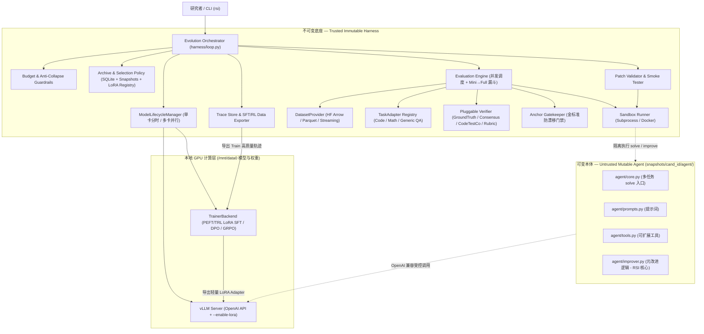
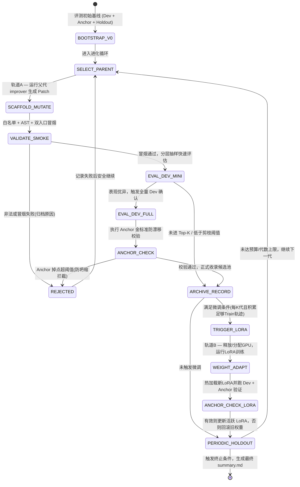

# 02. 系统架构设计说明书 (SAD)

- **文档版本**：v1.1
- **关联文档**：[01-srs.md](./01-srs.md) | [03-detailed-design.md](./03-detailed-design.md)

---

## 1. 本机硬件拓扑与存储基线

基于当前宿主机实测状态（6 × RTX 5090 32 GB、1 TB RAM、`/` 仅剩 ~630 MB、`/mnt/data0` 可用 254 GB），系统按以下物理资源策略运行：

### 1.1 存储目录隔离规范（强制）

所有大容量文件全部统一规划在 `/mnt/data0/rsi-workspace/` 下，并通过环境变量注入，绝不污染系统盘 `/`：

```text
/mnt/data0/rsi-workspace/
├── venv/                   # Python 3.11 独立虚拟环境（PyTorch CUDA 12.8+/13.x Blackwell, vLLM, TRL, PEFT）
├── hf_cache/               # HF_HOME & HF_DATASETS_CACHE（建议将 /root/.cache/huggingface 迁移至此）
├── models/                 # 本地基座模型（如 Qwen3-8B, Qwen2.5-Coder-7B-Instruct）
├── adapters/               # RSI 进化产出的 LoRA Checkpoints（仅保存轻量 adapter 权重）
└── runs/                   # 实验运行产物、Trace 日志与代码快照
```

### 1.2 GPU 双调度模式（单卡保底 + 多卡无缝扩展）

- **模式 A：单卡分时模式（Single-GPU Time-Sharing，MVP 默认，绑定空闲 GPU 1）**
  - *推理/进化期*：独占 GPU 1 启动 `vLLM`（BF16 `Qwen3-8B` ~16 GB + KV Cache ~12 GB + `--enable-lora`）。
  - *微调期*：由 `ModelLifecycleManager` 优雅关闭 `vLLM` 确认显存归零 → 启动单卡 BF16 LoRA SFT（`gradient_checkpointing=True`，峰值 ~24–28 GB）→ 导出轻量 `adapter_vN` → 重启 `vLLM` 并热挂载新 Adapter。
- **模式 B：多卡并行模式（Multi-GPU Split，当空出 ≥2 卡时仅改配置启用）**
  - `serving_gpus: [1]` 常驻 `vLLM` 服务（支持动态 LoRA 注册），`training_gpus: [2]` 独立执行 LoRA SFT / GRPO 微调，推理与训练完全零停机。

---

## 2. 核心架构设计原则

1. **双层信任边界（Immutable Harness vs. Mutable Agent）**：外层 Harness 绝对可信，内层 `agent/` 视为不可信代码，仅在沙箱中隔离运行，严禁反向导入或修改 Harness。
2. **双轨递归自进化（Dual-Track RSI）**：
   - **轨道 A（Scaffold 进化）**：演化 `agent/` 源码（含 `improver.py`），以极低成本快速探索新推理流、新工具与新反思策略。
   - **轨道 B（Weight 微调）**：当 Scaffold 在 `Train` 集产出高质量验证轨迹后，通过 LoRA 微调固化进基座权重，提升下一轮探索的能力下限。
3. **任务与验证高度解耦（Plugin Registry）**：通过 `DatasetProvider` + `TaskAdapter` + `Verifier` 三层插件化，实现从百条代码题到十万级通用/无标签数据集的平滑扩展。
4. **分层过滤漏斗（Fail-Fast Funnel）**：
   `路径/AST 静态校验 (ms)` → `双入口冒烟测试 (秒级)` → `Dev-Mini 快速筛选` → `Dev-Full 确认` → `Anchor Gatekeeper 防坍缩门禁` → `Holdout 隐藏终评`。

---

## 3. 系统总体分层架构图



---

## 4. 双轨进化控制流与状态机



---

## 5. 核心子系统职责与扩展设计

| 子系统                      | 所在路径                               | 核心职责                                                            | 泛用性 / 关键设计要点                                                                               |
| :-------------------------- | :------------------------------------- | :------------------------------------------------------------------ | :-------------------------------------------------------------------------------------------------- |
| **Orchestrator**      | `harness/loop.py`                    | 驱动双轨进化状态机、触发 LoRA 微调、断点续跑                        | 轨道 A（Scaffold）与轨道 B（Weight）均可在配置中独立开关                                            |
| **DatasetProvider**   | `harness/data.py`                    | 统一加载 `train/dev/holdout/anchor`，支持大数据集流式与分层子采样 | 封装 HF `datasets`（Arrow/Parquet）；通过固定随机种子支持可复现的 `dev_mini` 漏斗               |
| **TaskAdapter**       | `harness/adapters/`                  | 负责特定任务域的 Prompt 渲染与输出提取                              | 注册表模式；内置 `code`（MBPP+/BigCodeBench）、`math`（MATH-500）、`qa`                       |
| **Verifier**          | `harness/verifiers/`                 | 为每道题输出验证得分、置信度与诊断日志                              | 统一兼容有标签（`pytest`/`math-verify`）与无标签（`Consensus` / `CodeTestCo` / `Rubric`） |
| **ModelLifecycle**    | `harness/lifecycle.py`               | 管理本地 `vLLM` 服务、动态 LoRA 注册与显存切换                    | 支持单卡分时（stop vLLM → train → restart）与多卡并行，也支持外部 API 直连模式                    |
| **TrainerBackend**    | `harness/trainer.py`                 | 将筛选后的 Train 轨迹转为微调数据并运行 LoRA 训练                   | 默认实现 `TRLLoRASFTTrainer`（BF16 LoRA + KL/Replay 防坍缩），预留 DPO / GRPO 接口                |
| **Sandbox & Patcher** | `harness/sandbox.py`, `patcher.py` | 隔离执行不可信代码、校验补丁白名单与双入口契约                      | Subprocess / Docker 双模式；进程间采用临时目录 JSON 文件通信防 stdout 污染                          |
| **Archive & Anchor**  | `harness/archive.py`                 | SQLite 持久化双轨谱系，执行父代采样与 Anchor 门禁                   | 同时记录 `(scaffold_snapshot_id, lora_adapter_id)` 组合坐标                                       |

---

## 6. 安全、防作弊与无标签防坍缩纵深防线

1. **文件系统与数据隔离**：
   - Patcher 严格限制写入范围在 `snapshots/<cand_id>/agent/`，拦截路径穿越与 Symlink。
   - `holdout` 与 `anchor` 集绝不传入反思上下文、绝不挂载进沙箱。
   - 存储写入守卫检查：除临时运行目录外，大文件缓存与模型产物必须位于配置指定的 `/mnt/data0` 路径内。
2. **评测防篡改（Immutable Verifier）**：代码解答先脱离 Agent 沙箱，再拷贝至干净目录注入不可变单元测试执行。
3. **无标签防坍缩与防回音室**：
   - **置信度门控**：`ConsensusVerifier` 丢弃共识比例低于阈值（如 `< 0.6`）的样本，拒绝把高噪声伪标签送入反思或微调。
   - **微调正则与回放**：LoRA 训练限制学习率与 Rank，支持混入基座通用 Replay 数据并监控输出熵变化。
   - **Anchor Gatekeeper 强制门禁**：任何版本（尤其无标签迭代或 LoRA 更新）在 Anchor 集上掉点超过 `max_anchor_drop`（默认 3%）即自动回滚。

---

## 7. 代码仓库目录结构规划

```text
rsi-agent-mvp/
├── docs/                           # 软件工程文档（v1.1）
├── pyproject.toml                  # 依赖、ruff/mypy/pytest 与 rsi CLI 入口
├── .env.example                    # 环境变量模板（HF_HOME=/mnt/data0/... 等）
├── configs/
│   ├── code_mbpp_plus.yaml         # Stage 1：MBPP+ 快速闭环配置
│   ├── code_bigcodebench.yaml      # Stage 2：BigCodeBench 双轨 RSI 主配置
│   ├── math_500.yaml               # 跨领域泛化验证配置
│   └── labelfree_consensus.yaml    # 无标签共识进化 + Anchor 门禁配置
├── src/
│   └── rsi_mvp/
│       ├── cli.py                  # CLI 入口（run/eval/serve/train-lora/inspect/diff/report）
│       ├── schemas.py              # 全局任务无关 Pydantic v2 数据契约
│       ├── harness/                # 【不可变底座】Agent 禁止修改
│       │   ├── loop.py             # 双轨进化主循环 Orchestrator
│       │   ├── llm.py              # OpenAI 兼容客户端、Mock 客户端、计费与熔断
│       │   ├── lifecycle.py        # vLLM 启停、LoRA 热加载与单/多卡显存协调
│       │   ├── trainer.py          # LoRA 微调后端（TRL SFT / Mock Trainer）
│       │   ├── data.py             # DatasetProvider（JSONL/Parquet/HF Datasets + Mini抽样）
│       │   ├── adapters/           # TaskAdapter 插件（base, code, math, qa）
│       │   ├── verifiers/          # Verifier 插件（ground_truth, consensus, code_test_co, rubric）
│       │   ├── evaluator.py        # 并发评测引擎与 Anchor Gatekeeper
│       │   ├── sandbox.py          # SandboxExecutor (Subprocess / Docker)
│       │   ├── worker_entry.py     # 沙箱内只读胶水脚本
│       │   ├── patcher.py          # 补丁白名单校验、AST检查、Diff生成与双入口冒烟
│       │   ├── archive.py          # SQLite 双轨谱系存储与选择策略
│       │   └── reporter.py         # Markdown 实验报告生成器
│       └── agent/                  # 【可变种子模板 v0】
│           ├── __init__.py
│           ├── core.py             # 通用解题主循环（支持单次 / K次采样）
│           ├── prompts.py          # 提示词模板
│           ├── tools.py            # 可扩展工具集
│           └── improver.py         # 元改进器（RSI 递归核心）
├── scripts/
│   ├── setup_env.sh                # 在 /mnt/data0 初始化 venv、HF_HOME 与依赖
│   └── prepare_datasets.py         # 下载并分层切分 MBPP+ / BigCodeBench / MATH-500
└── tests/
    ├── unit/
    ├── integration/
    └── security/
```

---

## 8. 架构决策记录（ADR 摘要）

| 决策项                   | 选型                                                 | 理由                                                                                                                                                             |
| :----------------------- | :--------------------------------------------------- | :--------------------------------------------------------------------------------------------------------------------------------------------------------------- |
| **主力基座模型**   | `Qwen3-8B`（备选 `Qwen2.5-Coder-7B-Instruct`）   | BF16 ~16 GB 完美契合单卡 32 GB RTX 5090；兼具强编码、数学、工具调用与思考开关，满足多任务泛用性；本机已缓存的 `DeepSeek-R1-Distill-Qwen-7B` 可先作零下载烟测。 |
| **推理与权重热切** | `vLLM` + `--enable-lora`                         | OpenAI 兼容协议解耦上层代码；多代 LoRA Adapter 仅占几十 MB 且支持动态加载，节省磁盘与重启开销。                                                                  |
| **微调方案**       | `PEFT` + `TRL`（首期 LoRA SFT，预留 DPO/GRPO）   | 轻量化 Python 原生集成，单卡 32 GB 运行 BF16 LoRA 稳定可控，支持 KL/Replay 防坍缩。                                                                              |
| **大数据集供给**   | HuggingFace `datasets` + `Mini→Full` 漏斗       | Arrow 内存映射支持十万级数据不爆内存；两级评测保证大型数据集上每代迭代仍保持分钟级反馈。                                                                         |
| **无标签验证策略** | 可插拔 `LabelFreeVerifier` + `Anchor Gatekeeper` | 避免纯自评导致模型坍缩；通过共识/交叉验证提供接地信号，由极小金标准锚点集把控安全底线。                                                                          |
