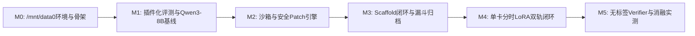

# 05. 研发实施计划与工程规范 (Implementation Plan)

- **文档版本**：v1.1
- **关联文档**：[01-srs.md](./01-srs.md) | [02-architecture.md](./02-architecture.md) | [03-detailed-design.md](./03-detailed-design.md) | [04-test-plan.md](./04-test-plan.md)

---

## 1. 研发里程碑规划（M0–M5）

采用**纵向切片、先立住本地单卡环境与有标签底座、再接入双轨微调与无标签扩展**的渐进式路线：

### M0：`/mnt/data0` 环境初始化与工程骨架（约 0.5 天）
- **交付物**：
  - `scripts/setup_env.sh`：在 `/mnt/data0/rsi-workspace/` 创建独立 `venv`、定向 `HF_HOME`、安装支持 Blackwell (`sm_120` / CUDA 12.8+/13.x) 的 `torch`、`vllm`、`peft`、`trl`、`datasets`、`pydantic`、`pytest`、`ruff`。
  - `pyproject.toml`、`.env.example`、`.gitignore`、`src/rsi_mvp/schemas.py`、`rsi doctor` 环境自检命令。
- **验收标志**：`rsi doctor` 通过（GPU 1 可见、PyTorch CUDA `sm_120` 矩阵乘正常、`/mnt/data0` 路径校验通过），Schema 单测全绿。

### M1：插件化评测底座与本地 `Qwen3-8B` 基线 `v0`（约 1 天）
- **交付物**：
  - `harness/data.py`（`DatasetProvider` + `scripts/prepare_datasets.py` 切分 `MBPP+` 与 `MATH-500` 四分集）
  - `harness/adapters/`（`code`, `math`）与 `harness/verifiers/ground_truth.py`
  - `harness/llm.py`（`OpenAICompatibleClient` + `MockLLMClient`）与基础 `vLLM` 服务脚本
  - 种子 `agent/`（`v0`）
- **验收标志**：本地单卡 RTX 5090 成功跑起 `Qwen3-8B`（或已缓存模型烟测），完成 `MBPP+` 与 `MATH-500` 的 `v0` 基线评估。

### M2：隔离沙箱与安全 Patch 引擎（约 1 天）
- **交付物**：
  - `harness/sandbox.py` + `harness/worker_entry.py`（`SubprocessSandbox` + `DockerSandbox`）
  - `harness/patcher.py`（路径白名单、结构化块替换、AST 校验、Diff 生成、双入口冒烟）
  - `tests/security/` 安全对抗测试（`SEC-01` ~ `SEC-07`, `SEC-09`）
- **验收标志**：安全测试套件全部通过，任意破坏性补丁均被拦截且不影响主循环。

### M3：Scaffold RSI 主循环、两级漏斗与归档（约 1 天）
- **交付物**：
  - `harness/archive.py`（SQLite 双轨谱系存储、`hill_climbing` + `evolutionary_archive`）
  - `harness/evaluator.py`（高并发评测 + `dev_mini → dev_full` 两级漏斗 + `Anchor Gatekeeper`）
  - `harness/loop.py`（Orchestrator 状态机与 `--resume` 断点续跑）
  - `tests/integration/`（Mock 3 代闭环与续跑测试）
- **验收标志**：Mock 端到端全绿；在 `MBPP+` 上用真实 `Qwen3-8B` 跑通 3–5 代纯 Scaffold RSI。

### M4：单卡分时 LoRA 微调与双轨 RSI 联动（约 1 天）
- **交付物**：
  - `harness/lifecycle.py`（单卡分时停/启 vLLM 显存校验、多卡并行配置、LoRA 热加载注册）
  - `harness/trainer.py`（轨迹导出 SFT 数据 + `TRLLoRASFTTrainer` + Replay 防坍缩 + `MockTrainerBackend`）
  - `BigCodeBench`（280 题分层子集）接入与双轨闭环集成测试
- **验收标志**：在单张 GPU 1 上无人干预跑通“Scaffold 进化 → 停 vLLM → LoRA SFT → 重启 vLLM 热加载新 LoRA → Anchor/Holdout 校验”全流程。

### M5：无标签 Verifier 插件、CLI 报告与消融实验（约 1 天）
- **交付物**：
  - `harness/verifiers/consensus.py`（`ConsensusVerifier`）与 `code_test_co.py`（`CodeTestCoVerifier`）
  - `SEC-08`（Anchor 掉点回滚对抗测试）与 `TC-LF-01/02` 单测
  - `harness/reporter.py` 与完整 `cli.py`
  - 产出 `BigCodeBench` / `MATH-500` 的端到端实验报告与无标签对照结果
- **验收标志**：满足 [01-srs.md](./01-srs.md) 第 6 节全部 MVP v1.1 验收标准。

---

## 2. WBS 任务拆解与关键依赖

| 任务 ID | 任务名称 | 依赖 | 里程碑 |
| :--- | :--- | :--- | :--- |
| T0.1 | `/mnt/data0` 独立 venv、`HF_HOME` 与 Blackwell PyTorch/vLLM/TRL 环境搭建 | 无 | M0 |
| T0.2 | 初始化 `pyproject.toml`、`schemas.py`、`rsi doctor` 自检 | T0.1 | M0 |
| T1.1 | 实现 `DatasetProvider` 与 `prepare_datasets.py`（MBPP+ / BigCodeBench / MATH-500） | T0.2 | M1 |
| T1.2 | 实现 `TaskAdapter`（code/math）与 `GroundTruth` Verifiers | T0.2 | M1 |
| T1.3 | 实现 `harness/llm.py` 与基线种子 `agent/` (`v0`)，完成单卡基线跑通 | T1.1, T1.2 | M1 |
| T2.1 | 实现 `worker_entry.py`、`SubprocessSandbox` 与 `DockerSandbox` | T1.3 | M2 |
| T2.2 | 实现 `harness/patcher.py`（白名单 + AST + 双入口冒烟）及安全测试 | T2.1 | M2 |
| T3.1 | 实现 `harness/archive.py`（双轨谱系 SQLite + 选择策略） | T0.2 | M3 |
| T3.2 | 实现并发 `evaluator.py`（Mini→Full 漏斗 + Anchor Gatekeeper）与 `loop.py` | T1.2, T2.2, T3.1 | M3 |
| T4.1 | 实现 `ModelLifecycleManager`（单卡分时/多卡并行 + vLLM `--enable-lora`） | T1.3 | M4 |
| T4.2 | 实现 `TrainerBackend`（轨迹 SFT 导出 + 单卡 LoRA SFT + Replay 混配）并接入 `loop.py` | T3.2, T4.1 | M4 |
| T5.1 | 实现无标签 `ConsensusVerifier` 与 `CodeTestCoVerifier` 及其测试 | T3.2 | M5 |
| T5.2 | 实现 `reporter.py`、完善 `cli.py` 并运行真实端到端与无标签对照实验 | T4.2, T5.1 | M5 |

---

## 3. 工程研发规范

1. **代码质量与边界静态守卫**：
   - 使用 `ruff` 格式化与 Lint（行宽 100），`harness/` 与 `schemas.py` 强制通过 `mypy` 类型检查。
   - 单测静态扫描 `src/rsi_mvp/agent/`：严禁出现任何对 `rsi_mvp.harness` 的导入语句。
2. **存储与环境纪律（本机强约束）**：
   - 运行任何命令前加载 `.env`，确保 `HF_HOME=/mnt/data0/rsi-workspace/hf_cache`、`TMPDIR=/mnt/data0/rsi-workspace/tmp`、`PIP_CACHE_DIR=/mnt/data0/rsi-workspace/pip_cache`。
   - 建议先将 `/root/.cache/huggingface` 迁移至 `/mnt/data0/rsi-workspace/hf_cache` 并做软链接或改环境变量，彻底释放系统盘 `/` 空间。
3. **Git 提交规范（Conventional Commits）**：
   - 示例：`docs: upgrade MVP specs to v1.1 for local GPU, LoRA, and label-free RSI`、`feat(verifier): add label-free consensus verifier and anchor gatekeeper`。
   - `.gitignore` 忽略 `runs/`、`.env`、`*.db`、`__pycache__/`。

---

## 4. 风险清单与缓解措施（Risk Register）

| 风险 ID | 风险描述 | 影响 | 缓解措施 |
| :--- | :--- | :--- | :--- |
| **R-01** | **系统盘 `/` 仅剩 ~630 MB 空间耗尽** | 装包/缓存/Docker 镜像拉取直接失败甚至导致容器异常 | 强制所有缓存与产物定向 `/mnt/data0`；`rsi doctor` 启动前校验可用磁盘阈值；迁移现有 `/root/.cache/huggingface`。 |
| **R-02** | **RTX 5090 (`sm_120`) 与旧版 PyTorch / vLLM / FlashAttn 不兼容** | 启动推理或训练报 `no kernel image` | M0 阶段优先验证 PyTorch CUDA 12.8+/13.x 与 vLLM 对 `sm_120` 的实机冒烟，锁定验证通过的精确版本号。 |
| **R-03** | **多租户宿主机 GPU 显存争用或单卡切换 OOM** | 推理或微调进程崩溃 | 显式绑定 `CUDA_VISIBLE_DEVICES`；`ModelLifecycleManager` 在 `stop vLLM` 后轮询 `nvidia-smi` 确认显存释放再起训练；控制 LoRA batch/seq_len 留足显存余量。 |
| **R-04** | **LLM 输出补丁格式失败率高** | 有效变异率低、浪费算力 | 使用结构化 JSON Schema 输出 + 锚点局部替换；失败时允许同代 1 次格式修复重试。 |
| **R-05** | **Dev 集过拟合** | Dev 虚高、Holdout 不涨 | 周期性评测黑盒 Holdout 并计算 Overfit Gap；大型数据集启用分层抽样与多类题型混合。 |
| **R-06** | **无标签进化发生模型坍缩或回音室效应** | 伪标签越学越错、通用能力退化 | 强制共识置信度阈值过滤 + LoRA Replay 混配 + **`Anchor Gatekeeper` 硬拦截回滚**。 |
| **R-07** | **自改 `improver.py` 退化导致后续迭代停滞** | 失去自我改进能力 | 双入口冒烟测试强制校验 `propose_improvement`；`evolutionary_archive` 保留历史有效父代支持自然回退。 |
